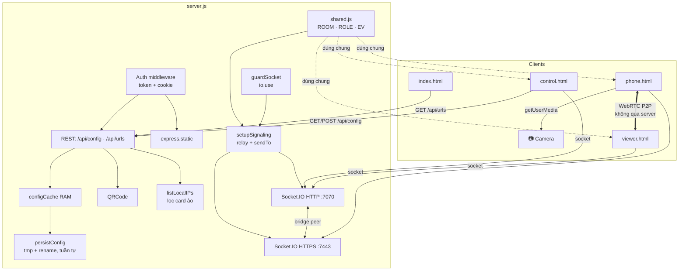
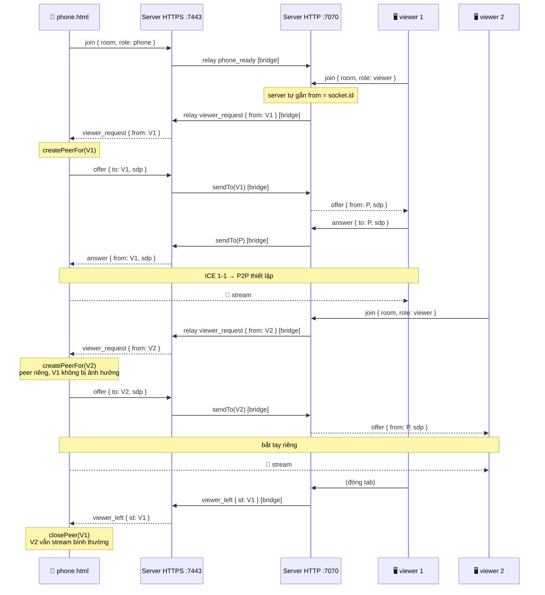
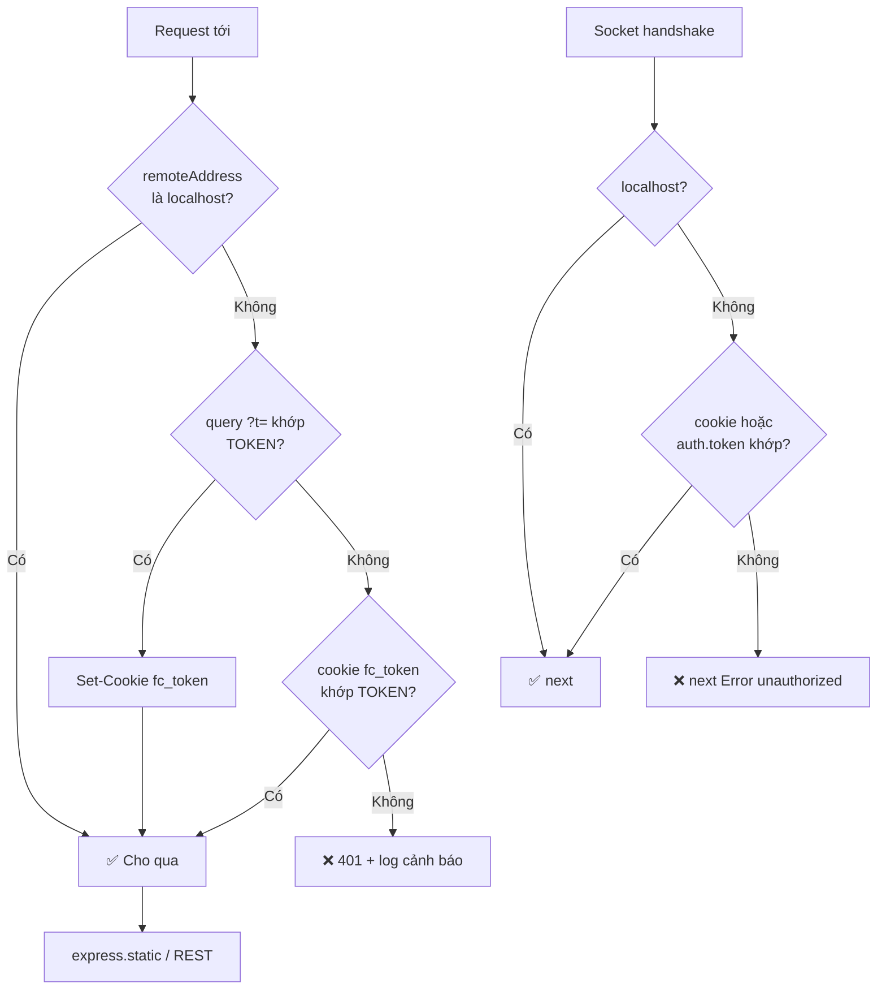
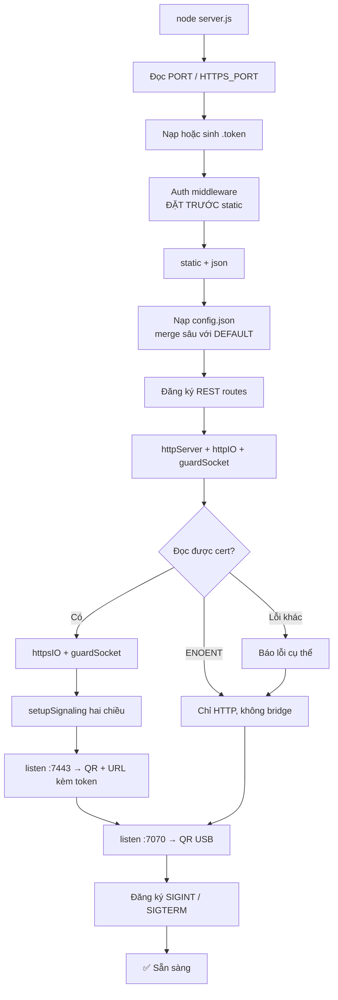

<!--
  Mission: Mô tả kiến trúc *hiện tại* của FaceCam Server — module, luồng signaling,
    use-case, rủi ro còn lại. Lịch sử "đã sửa gì, vì sao" nằm ở FINDINGS-2026-07-27.md.
  Author: DienJVo
  Version: 2.0.0
-->

# FaceCam Server — Architecture Audit

> **Phiên bản tài liệu:** 2.0 · **Cập nhật:** 2026-07-27
> **Phạm vi:** `server.js`, `init.js`, `public/` (4 trang + `shared.js`)
> **Phản ánh code tại thời điểm:** sau đợt rà soát 2026-07-27

**Lịch sử tài liệu**
- **v2.0 (2026-07-27)** — viết lại theo code hiện tại: protocol signaling đã đổi sang định tuyến đích danh, thêm lớp xác thực, hỗ trợ nhiều viewer. Xem [FINDINGS-2026-07-27.md](FINDINGS-2026-07-27.md) để biết chi tiết từng thay đổi.
- **v1.0 (2026-06-22)** — bản gốc. Phần lớn rủi ro nêu trong đó đã được xử lý; các mục Risk/Refactor của bản cũ không còn áp dụng.

---

## Mục lục

1. [Tổng quan](#1-tổng-quan)
2. [Danh mục file & module](#2-danh-mục-file--module)
3. [Phân loại kiến trúc](#3-phân-loại-kiến-trúc)
4. [Đồ thị phụ thuộc](#4-đồ-thị-phụ-thuộc)
5. [Phân tích theo tính năng](#5-phân-tích-theo-tính-năng)
6. [Danh mục use-case](#6-danh-mục-use-case)
7. [Sơ đồ luồng](#7-sơ-đồ-luồng)
8. [Phân tích rủi ro](#8-phân-tích-rủi-ro)
9. [Chất lượng code](#9-chất-lượng-code)
10. [Điểm chất lượng kiến trúc](#10-điểm-chất-lượng-kiến-trúc)
11. [Khuyến nghị còn lại](#11-khuyến-nghị-còn-lại)
12. [Kết luận](#12-kết-luận)

---

## 1. Tổng quan

FaceCam Server biến điện thoại thành webcam qua WebRTC. Node.js **chỉ làm signaling** (trao đổi SDP/ICE); video đi **P2P trực tiếp** giữa phone và PC, không bao giờ qua tiến trình Node.

**Stack:**

| Tầng | Công nghệ |
|---|---|
| Runtime | Node.js ≥ 18 (`engines`) |
| HTTP | Express 5.x |
| Realtime | Socket.IO 4.x — chạy song song trên cả HTTP và HTTPS |
| Truyền video | WebRTC P2P (API sẵn của trình duyệt) |
| TLS | Self-signed cert sinh bởi OpenSSL, có SAN |
| Xác thực | Token 32-hex lưu file `.token`; localhost được miễn |
| QR | gói npm `qrcode` |
| Frontend | Vanilla JS, không build step |
| Config | File JSON trên đĩa + cache trong RAM |
| Database / Queue / Cache | Không có |

**Ràng buộc thiết kế cố ý:**
- `iceServers: []` — không STUN/TURN. Chỉ ghép được bằng host candidate → **phone và PC phải cùng subnet**. Đổi lại: không phụ thuộc dịch vụ ngoài, không rò rỉ IP.
- Một phòng duy nhất, hardcode `'facecam'` — phục vụ một phiên stream tại một thời điểm.
- Không database — config là một file JSON.

---

## 2. Danh mục file & module

```
node-cam-server/
├── server.js              ← backend một file: HTTP, HTTPS, auth, Socket.IO, REST, signaling
├── init.js                ← CLI setup: npm install, sinh cert có SAN, dò ADB
├── package.json
├── config.json            ← config runtime (gitignored, server tự tạo khi thiếu)
├── .token                 ← token xác thực (gitignored, bền qua restart)
├── cert.pem / key.pem     ← TLS self-signed (gitignored, sinh bởi init.js)
├── docs/
│   ├── ARCHITECTURE_AUDIT.md    ← tài liệu này — kiến trúc hiện tại
│   └── FINDINGS-2026-07-27.md   ← nhật ký rà soát & sửa lỗi
└── public/
    ├── shared.js          ← hằng số signaling + helper config, dùng chung server ↔ client
    ├── index.html         ← dashboard PC: QR USB/WiFi, chọn IP khi nhiều card mạng
    ├── phone.html         ← sender: getUserMedia → nhiều WebRTC offer
    ├── viewer.html        ← receiver: answer → <video> → nguồn cho OBS
    └── control.html       ← bảng điều khiển config, mở được trên điện thoại
```

**Số dòng:**

| File | Dòng | Trong đó JS | Trách nhiệm |
|---|---|---|---|
| `server.js` | 414 | 414 | Toàn bộ backend |
| `init.js` | 151 | 151 | Setup một lần |
| `public/shared.js` | 53 | 53 | Hằng số + helper dùng chung |
| `public/phone.html` | 835 | 375 | UI camera + WebRTC sender đa peer |
| `public/viewer.html` | 354 | 244 | UI receiver + stats |
| `public/control.html` | 295 | 102 | Bảng config |
| `public/index.html` | 281 | 34 | Dashboard QR |

### `public/shared.js` — nguồn duy nhất cho protocol

Viết theo UMD tối giản nên **cả hai phía cùng dùng một định nghĩa**:

```js
// server.js
const { ROLE, EV } = require('./public/shared.js')

// client
<script src="/shared.js"></script>
const { ROOM, ROLE, EV, RTC_CONFIG, fetchConfig, saveConfig } = FaceCam
```

Xuất ra: `ROOM`, `ROLE` (`phone`/`viewer`/`control`), `EV` (9 tên event), `RTC_CONFIG`, `fetchConfig()`, `saveConfig()`.

---

## 3. Phân loại kiến trúc

### Phân loại: **Monolith một file + client script phẳng**

Đây không phải Clean Architecture hay Hexagonal, mà là **relay server một mối quan tâm** — phù hợp với quy mô.

```
┌──────────────────────────────────────────────────────┐
│                  server.js (monolith)                │
│                                                      │
│  ┌────────┐ ┌────────┐ ┌──────────┐ ┌────────────┐  │
│  │  Auth  │ │ Express│ │Socket.IO │ │   Config   │  │
│  │ (token)│ │ Routes │ │Signaling │ │ cache + I/O│  │
│  └────────┘ └────────┘ └──────────┘ └────────────┘  │
│       ↓          ↓           ↓             ↓         │
│  ┌────────────────────────────────────────────────┐ │
│  │      Node HTTP :7070  +  HTTPS :7443           │ │
│  └────────────────────────────────────────────────┘ │
└──────────────────────────────────────────────────────┘
       ↕ Socket.IO          ↕ REST        ↕ static
┌──────────────┐   ┌──────────────┐   ┌──────────────┐
│  phone.html  │   │ viewer.html  │   │ control.html │
│  N peer conn │◄─►│  1 peer conn │   │  config UI   │
└──────────────┘P2P└──────────────┘   └──────────────┘
```

**Hướng phụ thuộc:** `server.js` → `express`, `socket.io`, `qrcode`, `crypto`, `fs`, `os`, `./public/shared.js`. Các client → `/socket.io/socket.io.js`, `/shared.js`, WebRTC API. Không có phụ thuộc vòng.

### Vi phạm kiến trúc còn lại

| Vi phạm | Vị trí | Mức độ | Ghi chú |
|---|---|---|---|
| Không tách concern trong `server.js` | Toàn file | Thấp | Chấp nhận được ở 414 dòng |
| `setupSignaling` giữ tham chiếu `peer` qua closure | `server.js` | Thấp | Vòng đời = vòng đời tiến trình |
| I/O config nằm thẳng trong route handler | `server.js` | Thấp | Đã có cache RAM + ghi atomic bất đồng bộ |
| Tên phòng `'facecam'` hardcode | `shared.js` | Thấp | Nhưng đã về **một** nguồn duy nhất |
| Ba trang client tự implement UI trạng thái riêng | `public/*.html` | Thấp | Cố ý — mỗi trang một dạng UI khác nhau |

---

## 4. Đồ thị phụ thuộc



---

## 5. Phân tích theo tính năng

### 5.1 Khởi động server

`node server.js` → chạy tuần tự từ trên xuống:

1. Đọc port từ `PORT` / `HTTPS_PORT`, mặc định 7070 / 7443.
2. Nạp hoặc sinh token (`.token`). Token hỏng định dạng → cảnh báo + sinh mới.
3. Đăng ký **auth middleware trước `express.static`** — thứ tự này bắt buộc, đặt sau thì static đã phục vụ file xong trước khi kiểm tra.
4. Nạp `config.json` với merge sâu 1 cấp; thiếu file hoặc JSON hỏng → dựng lại từ `DEFAULT_CONFIG`.
5. Tạo HTTP server + `httpIO`, gắn `guardSocket`.
6. Thử tạo HTTPS server. Đọc được cert → gắn `guardSocket`, gọi `setupSignaling` hai chiều (bridge). Không đọc được → chỉ HTTP, không bridge.
7. Đăng ký handler `SIGINT`/`SIGTERM`.

**Xử lý lỗi:**
- Port bận: `server.on('error')` — HTTP thì in hướng dẫn theo OS rồi thoát; HTTPS thì cảnh báo và chạy tiếp (USB mode vẫn dùng được).
- Thiếu cert (`ENOENT`): thông báo bình thường. Lỗi khác (key hỏng, sai quyền) được báo riêng.

---

### 5.2 Xác thực

Hai lớp, cùng một token:

```js
// Lớp HTTP — trước static
app.use((req, res, next) => {
  if (isLocalAddress(req.socket.remoteAddress)) return next()
  if (req.query.t === TOKEN) { /* set cookie */ return next() }
  if (readCookie(req.headers.cookie, 'fc_token') === TOKEN) return next()
  res.status(401).send(...)
})

// Lớp Socket.IO — chặn HTTP mà hở socket thì vô nghĩa
function guardSocket(io) {
  io.use((socket, next) => {
    if (isLocalAddress(socket.handshake.address)) return next()
    if (readCookie(socket.handshake.headers.cookie, 'fc_token') === TOKEN) return next()
    if (socket.handshake.auth?.token === TOKEN) return next()
    next(new Error('unauthorized'))
  })
}
```

**Quy tắc:** `127.0.0.1` / `::1` được miễn — bao gồm viewer trên PC, OBS, và **USB mode** (`adb reverse` khiến request đến dưới dạng localhost).

**Vì sao gác signaling là đủ:** video đi P2P, nhưng không trao đổi được SDP/ICE thì không dựng được kết nối nào.

**Vòng đời token:** sinh lần đầu, lưu `.token`, **giữ nguyên qua restart** — nếu không thì URL trong OBS Browser Source hỏng mỗi lần khởi động lại. Đổi token = xoá file `.token`.

---

### 5.3 API config

`configCache` trong RAM là nguồn sự thật; đĩa chỉ để bền vững.

**Đọc:** `GET /api/config` → trả thẳng cache, không chạm đĩa.

**Ghi:** `POST /api/config` → `sanitizeConfig()` → merge vào cache → `persistConfig()` bất đồng bộ.

`sanitizeConfig()` kiểm **từng field** theo kiểu và miền giá trị:

| Field | Hợp lệ |
|---|---|
| `flipH` / `flipV` / `hideControls` | boolean |
| `rotation` | 0 / 90 / 180 / 270 |
| `fit` | `cover` / `contain` |
| `filters.brightness` / `filters.contrast` | số thực 0.5–1.5 |
| `filters.saturate` | số thực 0–2 |
| `filters.hue` | số thực −30…30 |
| `filters.grayscale` / `filters.sepia` / `filters.softness` | số thực 0–1 |
| `filters.zoom` | số thực 1–3 |
| `phone.facingMode` | `environment` / `user` |
| `phone.audio` | boolean |
| `phone.width` / `phone.height` | số nguyên 160–4096 |
| `phone.frameRate` | số nguyên 1–120 |
| `phone.maxBitrate` | số nguyên 100 000–30 000 000 |

Dải của nhóm `filters` khai báo một lần trong `FILTER_RANGES` và phát ra qua `GET /api/filter-ranges`; `control.html` dựng slider từ đó thay vì hardcode min/max, nên UI không thể lệch với validate phía server.

Giá trị ngoài dải bị **từ chối** (giữ giá trị hiện tại), **không clamp** — `width: 0` là dữ liệu hỏng chứ không phải "hơi nhỏ", nâng lên 160 vẫn là ghi đè rác lên giá trị tốt. Key lạ bị loại. `__proto__` không có đường vào vì hàm chỉ đọc các field đã liệt kê.

**Ghi đĩa:** ghi `.tmp` → `rename` (atomic), nối chuỗi promise để tuần tự hoá. Lỗi ghi được `console.error`, không throw tiếp — config RAM vẫn đúng, chỉ mất tính bền vững.

---

### 5.4 Signaling — định tuyến đích danh

Đây là phần đổi nhiều nhất so với v1.0. Trước đây mọi event broadcast cả phòng; giờ SDP/ICE đi **1-1**.

**Bảng event** (định nghĩa ở `shared.js`):

| Event | Hướng | Payload | Mục đích |
|---|---|---|---|
| `join` | client → server | `{ room, role }` | Vào phòng, khai vai trò |
| `viewer_request` | viewer → phone | `{ from }` | "Cho tôi xem stream" |
| `phone_ready` | phone → viewer | — | "Tôi sẵn sàng, hỏi lại đi" |
| `offer` | phone → viewer | gửi `{ to, sdp }`, nhận `{ from, sdp }` | SDP offer |
| `answer` | viewer → phone | gửi `{ to, sdp }`, nhận `{ from, sdp }` | SDP answer |
| `ice` | hai chiều | gửi `{ to, candidate }`, nhận `{ from, candidate }` | ICE candidate |
| `viewer_left` | server → phone | `{ id }` | Dọn peer tương ứng |
| `phone_disconnected` | server → viewer | — | Phone rớt |
| `config_updated` | mọi hướng | — | Config đổi, tự fetch lại |

**Hai helper:**

```js
// Broadcast cả phòng, qua cả hai server
function relay(socket, peer, room, event, data) {
  socket.to(room).emit(event, data)
  peer?.to(room).emit(event, data)
}

// Gửi 1-1. Socket.IO cho mỗi socket tự join một room trùng id của nó,
// nên định tuyến đích danh dùng chung cơ chế to() và vẫn qua được bridge.
function sendTo(socket, peer, targetId, event, data) {
  if (!targetId) return
  socket.to(targetId).emit(event, data)
  peer?.to(targetId).emit(event, data)
}
```

**Chống mạo danh:** server **luôn gắn `socket.id` thật** vào `from`, bỏ qua giá trị client tự khai. Không có điều này thì một client có thể mạo danh viewer khác để cướp stream.

**Theo dõi vai trò:** `socket.data.role` và `socket.data.room` lưu lúc join. Cần thiết vì lúc `disconnect` thì `socket.rooms` đã bị Socket.IO xoá sạch.

---

### 5.5 Phone — nhiều peer connection

Phone giữ `Map<viewerId, { pc, pendingIce, iceRestarted }>` — một kết nối riêng cho mỗi viewer.

**Luồng chính:**
```
nhận viewer_request { from }
  → nếu peer của `from` đang new/connecting  → bỏ qua (chống vòng lặp dựng lại)
  → createPeerFor(from)
      → đóng peer cũ của viewer này nếu có
      → addTrack toàn bộ localStream
      → tuneVideoSender(pc)   // contentHint='detail', maxBitrate, maintain-resolution
      → createOffer → setLocalDescription → emit offer { to: from }
```

**Hàng đợi ICE:** mỗi entry có `pendingIce` riêng. Candidate tới trước `setRemoteDescription` được xếp hàng, nạp lại bằng `flushIce(entry)`.

**ICE restart:** peer chuyển `failed` → thử `createOffer({ iceRestart: true })` **một lần** (cờ `iceRestarted`) trước khi đóng hẳn. Xử lý trường hợp đổi mạng khiến ICE chết nhưng SDP vẫn dùng lại được.

**Đổi camera:** `startStream()` gọi `replaceTrack` cho **mọi** peer đang mở — không dựng lại connection nào.

**Điều khiển phần cứng:** `refreshCameraControls()` đọc `track.getCapabilities()`, hiện nút đèn và thanh zoom **chỉ khi** máy báo hỗ trợ. Không có API nào chạm được vào chế độ làm đẹp / xoá phông của app Camera hãng — những cái đó nằm trong app OEM, không phải năng lực của camera.

**Đánh đổi:** mỗi viewer là một luồng encode riêng → phone nóng và tốn pin hơn khi mở nhiều viewer.

---

### 5.6 Viewer — một peer connection + stats

Viewer chỉ kết nối tới phone nên giữ đúng một `pc`, cộng thêm `phoneId` để gửi answer/ICE đích danh.

**Phân biệt offer mới với offer ICE-restart:**
```js
const isRestart = pc && from === phoneId && pc.connectionState !== 'closed'
if (!isRestart) { /* dựng pc mới */ }
```
Nhờ vậy ICE restart **tái dùng** connection, không mất hình.

**Vòng retry:** `startRetry()` hỏi lại mỗi 5s cho tới khi có hình, tự dừng khi video chạy. Được kích hoạt lại khi: socket connect, `phone_disconnected`, `connectionState === 'failed'`, hoặc xử lý offer lỗi. Luôn `clearInterval` trước khi tạo mới.

**Stats:** `pc.getStats()` mỗi 2s, lọc `inbound-rtp` kind `video`, tính bitrate từ delta `bytesReceived`. Hiện `1280×720 · 30fps · 3.2 Mbps`.

**Xoay:** `applyTransform()` hoán đổi `width`/`height` element (`100vw` ↔ `100vh`) khi rotation là 90/270 — vì `transform: rotate()` không đổi layout box, không hoán đổi thì `object-fit: cover` crop sai.

**Keep-alive (cho OBS Browser Source):** Wake Lock + audio im lặng + vòng lặp WebGL. Có kiểm tra `gl` null, và resume `AudioContext` khi click / đổi visibility vì nó sinh ra ở trạng thái `suspended` khi chưa có user gesture.

---

### 5.7 Đồng bộ config giữa ba trang

Cả ba trang đều: `POST /api/config` → `emit('config_updated')` → các trang khác `fetchConfig()` rồi cập nhật UI.

`control.html` **có join phòng** với role `control` — bắt buộc, vì server relay `config_updated` theo phòng.

> **Hạn chế đã biết (TOCTOU):** event `config_updated` không mang payload, bên nhận phải fetch riêng. Hai thay đổi liên tiếp có thể khiến response về không đúng thứ tự. Đã cân nhắc nhét config vào payload nhưng chưa làm — xác suất thấp ở quy mô một người dùng.

---

### 5.8 Bridge HTTP ↔ HTTPS

Khi có cert, `setupSignaling` được gọi hai lần, mỗi lần với `peer` là io còn lại:

```js
setupSignaling(httpsIO, httpIO, 'HTTPS')
setupSignaling(httpIO, httpsIO, 'HTTP')
```

Cần thiết vì phone thường ở HTTPS (WiFi) còn viewer ở HTTP (localhost) — hai instance Socket.IO tách biệt.

Mỗi event gửi sang cả hai phía; phía không có người nhận thì rơi vào phòng rỗng — vô hại. Định tuyến đích danh cũng hoạt động qua bridge, vì socket id là một room ngầm.

---

### 5.9 Phát hiện IP LAN

```js
const VIRTUAL_IFACE = /virtual|vmware|virtualbox|vethernet|hyper-?v|docker|tailscale|zerotier|tap-|tun\d|loopback/i
```

`listLocalIPs()` loại IPv4 internal và APIPA `169.254.x`, rồi xếp: **card thật trước card ảo**, trong nhóm card thật ưu tiên Wi-Fi rồi Ethernet.

Cần thiết vì card ảo (WSL, Docker, VirtualBox, VPN) cũng là IPv4 non-internal — chọn nhầm thì QR trỏ vào IP mà phone không tới được.

`/api/urls` nhận tham số `?ip=`, nhưng **chỉ chấp nhận IP thật có trên máy** để endpoint không thành công cụ sinh QR tuỳ ý. `index.html` hiện dropdown chọn IP khi máy có nhiều hơn một card.

---

### 5.10 Bộ lọc hình ảnh (Tầng A — CSS)

Hiệu ứng áp ở **viewer**, không ở phone. Lý do: PC khoẻ hơn nên phone chỉ lo encode (không nóng thêm, không tụt fps, không thêm latency), và OBS Browser Source render cả trang nên thấy kết quả mà không cần thêm bước nào.

**Hai lớp `<video>` chồng nhau, dùng chung một `MediaStream`:**

```js
video.style.filter     = css                    // bản sắc nét
videoSoft.style.filter = `${css} blur(6px)`     // bản mờ chồng lên
videoSoft.style.opacity = filters.softness      // độ mờ = mức "làm mịn"
```

Cả hai element cùng `srcObject` nên **không tốn thêm băng thông hay decode** — chỉ là hai lần vẽ từ một nguồn, GPU composite.

**Phân chia filter và transform:**
- Màu sắc (`brightness`, `contrast`, `saturate`, `hue`, `grayscale`, `sepia`) → `style.filter`
- `zoom` → nối vào `style.transform` cùng với rotation/flip, vì nó là biến đổi hình học chứ không phải màu

`applyTransform()` phải áp cho **cả hai lớp**, và vẫn giữ quy tắc hoán đổi `width`/`height` ở 90°/270° (xem 5.6).

**Panel chỉnh nằm ngay trên viewer.** Slider áp filter **local trước rồi mới lưu**, việc ghi đĩa và báo các trang khác được gom lại sau 300ms — nên kéo slider mượt từng frame thay vì giật theo nhịp round-trip. Chỉnh từ `control.html` cũng được nhưng phải chờ một vòng mạng.

Panel đóng theo thanh điều khiển (`hideControls`, nút ✕). Không có ràng buộc này thì nó nằm lại trên khung hình mà không còn nút nào để tắt, và **OBS sẽ thu cả panel vào stream**.

**`fit`: `cover` hay `contain`.** `cover` lấp đầy màn hình nhưng cắt rìa — nguồn 1080×720 trên màn 1920×1080 bị phóng 1.78× và mất ~25% chiều cao. `contain` giữ toàn bộ khung camera, đổi lại có viền đen. Đổi được ngay trên viewer vì đây là thứ phải nhìn mới quyết được.

**Gợi ý bitrate.** `recommendedBitrate()` tính từ số pixel mỗi giây (~0.1 bit/pixel/frame) thay vì tra bảng, nên kích thước tuỳ chỉnh và fps bất kỳ đều ra con số hợp lý. Làm tròn tới bội số 0.5 Mbps **gần nhất** chứ không làm tròn lên — 1080p ra 6.22 Mbps, ép lên 6.5 thì không khớp mức nào trong dropdown. Vì phần lớn mức đề xuất (3, 11, 25 Mbps) không có sẵn, cả độ phân giải lẫn bitrate đều phải có đường nhập tay; thiếu nó thì cảnh báo chỉ ra lệnh mà không cho cách thực hiện.

**Giới hạn cố ý:** CSS filter áp cho toàn khung hình. "Làm mịn" ở đây là soft glow chứ không phải bilateral filter, và không xoá được phông. Muốn hai thứ đó phải sang Tầng B (xem R7).

**Không đặt ở phone được:** CSS filter trên `<video>` của phone chỉ đổi lúc **hiển thị** — track gửi qua WebRTC vẫn là track gốc từ `getUserMedia`. Muốn hiệu ứng đi vào stream thì phải qua `canvas.captureStream()` hoặc Insertable Streams, đắt hơn nhiều.

---

### 5.11 `init.js`

Bốn bước: kiểm `node_modules` → sinh cert → kiểm `config.json` → dò ADB.

**Cert:** tự lấy IP LAN, thêm `-addext "subjectAltName=IP:<ip>,IP:127.0.0.1,DNS:facecam,DNS:localhost"`. Chrome bỏ qua trường CN từ bản 58, chỉ đọc SAN. Có nhánh dự phòng cho OpenSSL < 1.1.1 (tạo cert không SAN nhưng nói rõ hệ quả). Với cert sẵn có thì phân biệt "không có SAN" và "SAN trỏ IP cũ".

**Config:** **không** tự tạo nữa — `server.js` đã dựng từ `DEFAULT_CONFIG` khi thiếu. Giữ bản default thứ hai ở đây từng khiến hai bên trôi dạt (`init.js` thiếu `maxBitrate`).

**ADB:** chỉ dò path của đúng OS đang chạy.

---

## 6. Danh mục use-case

### UC-01 · Khởi động server
| | |
|---|---|
| **Vào** | `npm start` (hoặc `PORT=... npm start`) |
| **Ra** | Hai server listening, QR + URL kèm token trong terminal |
| **Quy tắc** | HTTPS tuỳ chọn; HTTP bắt buộc |
| **Phụ thuộc** | `public/`; cert (tuỳ chọn); `config.json` và `.token` tự tạo nếu thiếu |
| **Thất bại** | Port bận → thông báo theo OS, HTTP thì thoát, HTTPS thì chạy tiếp |

### UC-02 · Phone kết nối & stream
| | |
|---|---|
| **Vào** | Quét QR (kèm token) → chạm "Bật Camera" |
| **Ra** | `localStream` chạy, `phone_ready` phát đi |
| **Quy tắc** | Camera chỉ mở sau thao tác người dùng; dùng ràng buộc `ideal` |
| **Thất bại** | Từ chối quyền → hiện lỗi ở status; thiếu token → 401 trước cả khi tải trang |
| **Trình tự** | nạp config → socket connect → join role=phone → chờ chạm → getUserMedia → getCameras → đọc capabilities → emit phone_ready |

### UC-03 · Viewer kết nối & nhận hình
| | |
|---|---|
| **Vào** | Mở `viewer.html` (localhost thì không cần token) |
| **Ra** | `<video>` phát hình, stats cập nhật mỗi 2s |
| **Quy tắc** | Viewer chủ động hỏi; phone quyết định tạo offer |
| **Thất bại** | Phone chưa bật → "Chờ phone..." + retry 5s |
| **Trình tự** | keepAlive → connect → join role=viewer → server tự bắn viewer_request hộ → nhận offer → answer → ICE → ontrack → startStats |

### UC-04 · Nhiều viewer cùng lúc
| | |
|---|---|
| **Vào** | Viewer thứ hai mở trang (ví dụ: tab canh chỉnh + OBS Browser Source) |
| **Ra** | Phone tạo peer connection **thứ hai**, cả hai cùng nhận hình |
| **Quy tắc** | Mỗi viewer một peer riêng; đóng một cái không ảnh hưởng cái kia |
| **Đánh đổi** | Phone encode nhiều luồng → nóng và tốn pin hơn |
| **Dọn dẹp** | `viewer_left { id }` → phone đóng đúng peer đó |

### UC-05 · Cập nhật config
| | |
|---|---|
| **Vào** | Thao tác trên `control.html`, quick bar phone, hoặc nút viewer |
| **Ra** | `config.json` cập nhật; các trang khác đồng bộ qua `config_updated` |
| **Quy tắc** | Merge sâu cho `phone`; giá trị ngoài dải bị từ chối; `maxBitrate` áp ngay, độ phân giải cần bật lại camera |
| **Thất bại** | Ghi đĩa lỗi → log, config RAM vẫn đúng |

### UC-06 · Phone rớt kết nối
| | |
|---|---|
| **Vào** | Phone đóng trang / mất mạng |
| **Ra** | `phone_disconnected` chỉ gửi cho viewer (kiểm role) |
| **Quy tắc** | Viewer đóng tab **không** kích hoạt event này |
| **Hồi phục** | Viewer xoá `srcObject`, bật lại vòng retry |

### UC-07 · Phone vào lại
| | |
|---|---|
| **Vào** | Phone reconnect sau khi rớt |
| **Ra** | `phone_ready` → viewer hỏi lại → offer mới |
| **Quy tắc** | Không cần thao tác tay ở cả hai phía |

### UC-08 · Đổi mạng giữa chừng
| | |
|---|---|
| **Vào** | Phone đổi AP / chuyển WiFi ↔ 4G khiến ICE chết |
| **Ra** | Thử ICE restart một lần; thất bại thì đóng peer và chờ viewer hỏi lại |
| **Quy tắc** | Viewer tái dùng peer connection khi nhận offer restart |

---

## 7. Sơ đồ luồng

### 7.1 Signaling — hai viewer, định tuyến đích danh



### 7.2 Xác thực



### 7.3 Khởi động



---

## 8. Phân tích rủi ro

### 8.1 Race condition

| ID | Vị trí | Mô tả | Mức | Trạng thái |
|---|---|---|---|---|
| RC-01 | `POST /api/config` | Ghi đồng thời vào `config.json` | — | **Đã xử lý** — cache RAM là nguồn sự thật, ghi atomic và tuần tự hoá |
| RC-02 | `config_updated` | Bên nhận fetch riêng, hai thay đổi liên tiếp có thể về sai thứ tự | Thấp | **Còn** — xác suất thấp ở một người dùng |
| RC-03 | `viewer_request` trùng lặp | Viewer retry trong lúc đang bắt tay | — | **Đã xử lý** — bỏ qua khi peer `new`/`connecting` |
| RC-04 | `retryTimer` | Nhiều `setInterval` chồng nhau khi reconnect | — | **Đã xử lý** — luôn `clearInterval` trước |
| RC-05 | ICE trước SDP | `addIceCandidate` ném `InvalidStateError`, mất candidate | — | **Đã xử lý** — hàng đợi `pendingIce` mỗi peer |

### 8.2 Rò rỉ bộ nhớ

| ID | Vị trí | Mô tả | Trạng thái |
|---|---|---|---|
| ML-01 | `viewer.html` `pc` | Peer cũ không đóng khi có offer mới | **Đã xử lý** — `close()` trước khi tạo mới, trừ trường hợp ICE restart (cố ý tái dùng) |
| ML-02 | `retryTimer` | Interval chồng nhau | **Đã xử lý** |
| ML-03 | `keepAlive` | RAF loop, AudioContext, canvas không dọn | **Còn** — cố ý, vòng đời = vòng đời trang OBS |
| ML-04 | `peers` Map ở phone | Peer chết tích lại | **Đã xử lý** — `viewer_left` + `closePeer()` khi `failed` |
| ML-05 | `statsTimer` | Interval stats ở viewer | **Đã xử lý** — `stopStats()` khi mất kết nối |

### 8.3 Bảo mật

| ID | Mô tả | Mức | Trạng thái |
|---|---|---|---|
| SEC-01 | Không validate body `POST /api/config` | — | **Đã xử lý** — `sanitizeConfig()` kiểm kiểu + miền giá trị |
| SEC-02 | `config.json` hỏng làm server chết | — | **Đã xử lý** — try/catch, dựng lại từ default |
| SEC-03 | Không xác thực — ai trong LAN cũng xem được camera | — | **Đã xử lý** — token cho thiết bị LAN, localhost miễn |
| SEC-04 | `/api/urls` lộ IP LAN | — | **Đã xử lý** — nằm sau lớp auth |
| SEC-05 | Không CSRF | Thấp | **Còn** — cookie `SameSite=Lax`, cùng origin |
| SEC-06 | Cert không có SAN | Thấp | **Một phần** — `init.js` đã sinh cert có SAN, nhưng cert cũ trên máy chưa tạo lại |
| SEC-07 | Client mạo danh viewer khác | — | **Đã xử lý** — server luôn gắn `socket.id` thật |
| SEC-08 | Không rate limit | Thấp | **Còn** — cố ý; sau SEC-03 thì người lạ không vào được để spam |

### 8.4 Giới hạn quy mô

Đây là công cụ LAN một người dùng. Ghi lại cho đầy đủ:

| Giới hạn | Ảnh hưởng |
|---|---|
| Một phòng hardcode `'facecam'` | Một phiên stream tại một thời điểm; không hỗ trợ nhiều người dùng |
| Phone encode một luồng mỗi viewer | Mở nhiều viewer làm phone nóng, tụt fps |
| Không STUN/TURN | Bắt buộc cùng subnet |
| Config một file | Không scale ngang |
| Không giới hạn số kết nối | Chấp nhận được sau khi có auth |

---

## 9. Chất lượng code

### 9.1 Code chết
Không còn. `setStatus()` ở `viewer.html` trước đây định nghĩa mà không gọi, nay đã được dùng thật.

### 9.2 Trùng lặp

| Mẫu | Trạng thái |
|---|---|
| `socket.to()` + `peer?.to()` lặp 6 lần | **Đã gộp** — `relay()` / `sendTo()` |
| Tên event rải rác 4 file | **Đã gộp** — `shared.js` |
| `fetch('/api/config')` lặp ở 3 trang | **Đã gộp** — `fetchConfig()` / `saveConfig()` |
| `RTCPeerConnection({iceServers: []})` | **Đã gộp** — `RTC_CONFIG` |
| Hàm `setStatus` mỗi trang một kiểu | **Còn — cố ý**: mỗi trang một dạng UI khác nhau, gộp sẽ tạo abstraction cho code dùng một lần |
| `flushIce` ở phone và viewer | **Còn — cố ý**: phone quản nhiều peer, viewer một peer |

### 9.3 God object
`server.js` (414 dòng) vẫn làm: HTTP, HTTPS, TLS, auth, static, REST, phát hiện mạng, signaling hai instance, bridge, QR terminal, shutdown. Vẫn đọc được, nhưng đã đến ngưỡng nên cân nhắc tách nếu còn thêm tính năng.

### 9.4 Rò rỉ business logic
- Tên phòng `'facecam'`: vẫn hardcode nhưng đã về **một** nguồn (`shared.js`).
- Vai trò đã có protocol rõ ràng (`ROLE`), không còn suy đoán ngầm.

### 9.5 Ranh giới còn thiếu

| Ranh giới | Ảnh hưởng |
|---|---|
| Không có schema config chính thức | Validate viết tay trong `sanitizeConfig()`; thêm field phải sửa ba chỗ (server, phone, control) |
| Không có test tự động trong repo | Script test nằm ngoài repo, không chạy lại được tự động |
| Không có abstraction nhiều phòng | Muốn nhiều phiên đồng thời phải sửa cả `shared.js` lẫn cách join |
| Không có chiến lược reconnect riêng | Dùng mặc định của Socket.IO, không backoff luỹ thừa |

---

## 10. Điểm chất lượng kiến trúc

| Tiêu chí | v1.0 | **v2.0** | Lý do thay đổi |
|---|---|---|---|
| **Đúng đắn** | 8/10 | **9/10** | Đã sửa 11 bug thật gồm cả các lỗi chỉ lộ khi dùng hằng ngày |
| **Bảo trì** | 6/10 | **7/10** | Protocol về một nguồn, tách helper; nhưng vẫn là monolith một file |
| **Kiểm thử** | 3/10 | **5/10** | Đã có 30 test chạy được, nhưng chưa nằm trong repo/CI |
| **Bảo mật** | 5/10 | **8/10** | Auth hai lớp, validate đầu vào, chống mạo danh; trừ điểm vì cert chưa có SAN |
| **Khả năng mở rộng** | 2/10 | **4/10** | Nhiều viewer đã chạy; vẫn một phòng, vẫn không TURN |
| **Độ tin cậy** | 6/10 | **9/10** | Tự phục hồi sau reconnect, ICE restart, ghi atomic, graceful shutdown, xử lý lỗi port |
| **Khả năng quan sát** | 5/10 | **7/10** | Log có role/id, stats thời gian thực ở viewer; chưa có structured logging |
| **Trải nghiệm dev** | 9/10 | **9/10** | Vẫn tốt; thêm `npm run dev`, biến môi trường, thông báo lỗi rõ |
| **Tổng** | **6/10** | **7.5/10** | |

---

## 11. Khuyến nghị còn lại

### Ưu tiên 1 — đáng làm tiếp

**R1 · Đưa test vào repo.** 30 test hiện chạy từ scratchpad. Chuyển vào `test/`, thêm `npm test` dùng `node --test` (có sẵn từ Node 18, không cần dependency).

**R2 · Tạo lại cert có SAN.** Xoá `cert.pem` + `key.pem` rồi `npm run init`. Người dùng đã biết và chọn hoãn.

**R3 · Nhét config vào payload `config_updated`.** Bỏ được vòng fetch thứ hai và xử lý luôn RC-02.

### Ưu tiên 2 — khi cần mở rộng

**R4 · Tách `server.js`** thành `src/auth.js`, `src/config.js`, `src/signaling.js`, `src/network.js`. Chỉ đáng làm nếu còn thêm tính năng.

**R5 · Nhiều phòng.** Thay `ROOM` cố định bằng id phiên trong URL, cho phép nhiều cặp phone-viewer độc lập.

**R6 · ESLint + Prettier.** Cần thêm dependency.

### Ưu tiên 3 — tính năng

**R7 · Tầng B của bộ lọc hình ảnh.** Tầng A (CSS filter) **đã làm** — xem mục 5.10. Tầng B cần pipeline khác hẳn: `<video>` ẩn → xử lý từng frame bằng WebGL/canvas → `<canvas>` cho OBS capture. Chỉ khi đó mới có xoá/thay phông (MediaPipe Selfie Segmentation), làm mịn da thật (bilateral filter — mờ vùng phẳng nhưng giữ cạnh), LUT `.cube`, chroma key. Đánh đổi: tốn GPU của PC, thêm thư viện, và phải viết lại rotation/flip/`object-fit` bên trong canvas.

**R8 · Ghi hình phía viewer** bằng `MediaRecorder`.

---

## 12. Kết luận

FaceCam Server là **công cụ có phạm vi rõ ràng, hiện thực thực dụng**. Quyết định kiến trúc thú vị nhất vẫn là bridge signaling giữa hai instance Socket.IO trên HTTP và HTTPS — nó xử lý đúng trường hợp phổ biến nhất: phone dùng WiFi/HTTPS còn viewer dùng localhost/HTTP.

**Điểm mạnh:**
- Dấu chân tối thiểu — một file backend, không database
- Hiểu đúng mô hình bảo mật của WebRTC (HTTPS bắt buộc cho `getUserMedia` ngoài localhost)
- Video P2P — server không bao giờ nằm trên đường truyền hình
- Hạ tầng config đủ tốt để mọi tính năng mới (mic, filter…) chỉ là thêm một field
- Giới hạn cố ý (không STUN, một phòng) được ghi rõ chứ không giấu

**So với v1.0**, hệ thống đã đổi bản chất ở ba điểm:
1. **Từ một viewer sang nhiều viewer** — protocol chuyển từ broadcast sang định tuyến đích danh.
2. **Từ không có bảo mật sang có** — thiết bị LAN cần token, localhost được miễn để OBS chạy êm.
3. **Từ mong manh sang tự phục hồi** — reconnect, ICE restart, hàng đợi ICE, ghi atomic.

**Việc đáng làm nhất tiếp theo** là đưa bộ test vào repo. Codebase giờ đã có protocol đủ phức tạp (định tuyến đích danh, đa peer, ICE restart) để một thay đổi vô ý có thể phá vỡ mà không lộ ra ngay — đúng loại lỗi mà 30 test hiện có bắt được, nhưng chỉ khi chúng còn chạy được.
